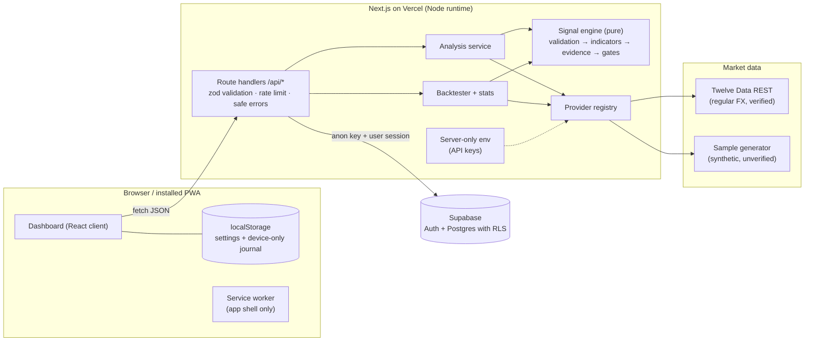

# Signal Desk

Rule-based analysis and alerts for 1-minute charts with a 1-minute expiry. Signal Desk outputs **CALL**, **PUT** or **NO TRADE** with every reason shown. It never places trades, never clicks anything for you, never asks for broker credentials and does not use unofficial Quotex APIs. You make every decision.

> No accuracy or profit is guaranteed. Binary options can lose the full stake on every trade. Past results do not guarantee future results.
> *Yeh sirf tajziya hai — har trade ka faisla aap khud karte hain. Munafa ki koi zamanat nahin.*

## Status at a glance

| Area | State |
|---|---|
| Dashboard (responsive, dark glass UI, Roman Urdu notes) | Implemented, E2E-tested on desktop and 390 px mobile |
| Safe default | NO TRADE until a verified live feed passes every gate |
| **Signal strategy** | **v2 exhaustion fade (default).** v1 trend rules lost on real history (48–49 %); v2 won 55.6 % on an untouched 2020 test period with on-time entry, 51.5 % one candle late. Full report: `docs/RESEARCH.md` |
| Real-data research harness | `scripts/research/` runs the real engine over 3.87 M OANDA 1-minute candles (6 pairs, 2018-07 → 2020-05) with a fixed train / validation / test split |
| v3 ML model (shadow only) | LightGBM, frozen; runs on every live scan beside v2 and is compared in Results; never alerts. Parity with the Python research verified to 1e-9 |
| Strategy health monitor | Pauses signals when the recent win rate is clearly (95 % CI) below break-even; v1 kept for rollback |
| Candle validation, freshness, gaps, look-ahead protection | Implemented and unit-tested |
| Indicators: EMA, SMA, RSI (Wilder), MACD, Bollinger, ATR | Implemented; cross-checked against an independent pandas implementation |
| Price action, structure, S/R zones, breakout/retest/false-breakout, patterns, 5 m confirmation, volatility filters | Implemented and unit-tested |
| Provider adapters | Interface + **sample** (synthetic, unverified) + **Twelve Data** (regular FX). Twelve Data parsing is tested against its documented response shape; **not exercised against the live API** (no key in the build environment) |
| OTC live data | **Not available** — no permitted provider publishes broker OTC quotes. OTC analysis always returns NO TRADE |
| News / economic-calendar filter | Hook implemented; **no provider configured** (signals carry a warning) |
| Screenshot upload | Validation + preview implemented. **Interpretation not implemented** (no vision/OCR provider configured); screenshots are never stored |
| Backtesting with in-sample / out-of-sample split | Implemented and tested; also scores every trade as if entered one candle late |
| Performance stats (win rate + 95% CI, break-even, net units, streaks, drawdown) | Implemented and tested |
| Accounts + saved journal (Supabase Auth magic link, Postgres + RLS) | Code and migration implemented; **RLS verified on real Postgres (PGlite)**; the end-to-end sign-in flow has **not** been run against a live Supabase project |
| Audit log | Structured server logs always; `audit_logs` table (append-only under RLS) when signed in |
| Rate limiting | In-memory, per instance (see Security) |
| PWA install on Android | Manifest, icons, shell-only service worker. Not a native APK — see `docs/ANDROID.md` |

## Architecture



The engine is a pure function of `(candles, symbol, market type, source, now, rules)`, so the same code runs for live analysis, backtests and tests. Provider keys exist only in server environment variables; the client bundle was scanned after build and contains none of them.

## Folder tree

```
signal-desk/
├─ .env.example                  environment template (no real values)
├─ next.config.ts                security headers, Cache Components
├─ playwright.config.ts          E2E smoke config
├─ vitest.config.mts             unit + DB test config
├─ docs/
│  ├─ RESEARCH.md                audit, loss analysis, v2 validation on real data
│  ├─ SIGNAL_RULES.md            every rule, weight and threshold; what the score means
│  ├─ DATA_SOURCES.md            provider research and how to add one
│  └─ ANDROID.md                 PWA now, native app as a later phase
├─ public/                       PWA icons, service worker
├─ scripts/gen_indicator_fixture.py   independent pandas reference for indicator tests
├─ scripts/research/             fetch-oanda.sh, ledger.ts (real engine over history), analyze.py, search_fade.py, compare.py
├─ supabase/migrations/20261013000000_init.sql
├─ src/
│  ├─ app/
│  │  ├─ page.tsx, layout.tsx, globals.css, manifest.ts
│  │  ├─ auth/callback/route.ts  magic-link landing
│  │  └─ api/
│  │     ├─ health/              source health + capabilities
│  │     ├─ symbols/             pairs a provider really offers
│  │     ├─ analyze/             run the engine on fresh candles
│  │     ├─ backtest/            walk-forward backtest
│  │     ├─ screenshot/          validate an upload (no interpretation)
│  │     ├─ journal/, journal/[id]/   user-scoped history + outcomes
│  │     └─ auth/login|logout|me
│  ├─ components/                Dashboard, SignalCard, CandleChart, AnalysisBreakdown,
│  │                             JournalPanel, BacktestPanel, ScreenshotPanel,
│  │                             SourcesPanel, SettingsPanel, Performance
│  └─ lib/   (ml/ = v3 shadow model: features.ts, model.ts, model-v3.json)
│     ├─ types.ts
│     ├─ config/rules.ts         all thresholds (zod-validated)
│     ├─ validation/             candles (OHLC, gaps, freshness), image sniffing
│     ├─ indicators/             EMA, SMA, RSI, MACD, Bollinger, ATR
│     ├─ analysis/               candle anatomy, patterns, swings, zones, breakouts, resampling
│     ├─ engine/signal.ts        CALL / PUT / NO TRADE
│     ├─ backtest/, stats/       walk-forward simulation, performance report
│     ├─ providers/              interface, sample, Twelve Data, registry
│     ├─ server/                 env, http/errors/rate limit, Supabase client, audit, analysis service
│     ├─ api/                    request schemas, response contracts
│     └─ client/                 fetch wrapper, local storage, sound, formatting
└─ tests/
   ├─ unit/                      indicators, validation, analysis, signal, stats/backtest, providers, API
   ├─ db/rls.test.ts             runs the real migration on PGlite and checks RLS
   ├─ e2e/smoke.spec.ts          Playwright, desktop + mobile
   └─ fixtures/indicators.json
```

## Environment variables

See `.env.example`.

| Variable | Where it is read | Purpose |
|---|---|---|
| `TWELVEDATA_API_KEY` | server only | Enables the verified live provider. Empty → "Live data unavailable", no live signals |
| `ENABLE_SAMPLE_PROVIDER` | server only | `true` lists the synthetic SAMPLE-* data (never tradable) |
| `NEXT_PUBLIC_SUPABASE_URL` | server + browser | Supabase project URL (public by design) |
| `NEXT_PUBLIC_SUPABASE_ANON_KEY` | server + browser | Supabase anon key (public by design; RLS protects data) |
| `RATE_LIMIT_PER_MINUTE` | server only | Per-IP limit for `/api/analyze` |

The Supabase **service-role key is not used anywhere**. All database access runs as the signed-in user, so row-level security applies to every query.

## Database

`supabase/migrations/20261013000000_init.sql` creates:

- `signal_records` — one row per saved analysis: source, pair, market type, analysis kind, decision, engine decision, signal candle time, entry reference, 60-second expiry, agreement score, rule version, evidence, reasons, and the observed outcome (`UNRESOLVED | WIN | LOSS | TIE`, entry/exit price, payout, resolved time). Demo-only by constraint. A trigger makes the signal evidence immutable; only outcome fields can change. A NO TRADE row can never be marked win/loss.
- `user_settings` — payout assumption, sound preference, rule overrides.
- `audit_logs` — append-only for users (insert/select own rows; no update/delete policy).

Every table has RLS enabled **and forced**, with `user_id = auth.uid()` policies; `anon` has no privileges.

## Setup on Windows (PowerShell)

Requires Node.js 20.9 or newer (22 LTS recommended) and Git.

```powershell
# 1. Get the code and install
cd $HOME\Projects
git clone <your-repo-url> signal-desk
cd signal-desk
npm ci

# 2. Environment
Copy-Item .env.example .env.local
notepad .env.local      # add TWELVEDATA_API_KEY and the Supabase values when you have them

# 3. Run locally
npm run dev             # http://localhost:3000

# 4. Checks
npm run typecheck
npm run lint
npm test                # unit + database (RLS) tests
# optional: re-run the real-data research (Python 3 + pandas) — see docs/RESEARCH.md
npx playwright install chromium
npm run build
npm run test:e2e        # starts `next start` on port 3200 and runs the smoke test
```

Without any keys the app runs fully, shows **Live data unavailable**, and lets you explore with the synthetic sample source.

### Supabase (optional, for accounts and saved history)

1. Create a project at supabase.com.
2. In the SQL editor, run `supabase/migrations/20261013000000_init.sql` (or `supabase db push` with the Supabase CLI).
3. Authentication → URL configuration: set the Site URL to your deployed URL and add `http://localhost:3000/auth/callback` and `https://<your-domain>/auth/callback` to the redirect allow-list.
4. Put the project URL and anon key in `.env.local`.

## Deploying to Vercel

1. Push the repository to GitHub and import it in Vercel (framework preset: Next.js; build command `next build`).
2. Project → Settings → Environment Variables: add the variables above for Production (and Preview if you want). Leave `TWELVEDATA_API_KEY` unset to deploy in "no live data" mode.
3. Deploy. Then add `https://<your-domain>/auth/callback` to Supabase's redirect URLs.
4. On Android Chrome, open the HTTPS site and choose **Install app**.

## Security

- **Input validation** — every route parses its input with strict zod schemas (unknown fields rejected, symbols and providers pattern-checked, body size capped).
- **Safe errors** — users see short, fixed messages; upstream bodies and stack traces stay in server logs (with a request id).
- **Secrets** — provider keys are read only in `src/lib/server/env.ts`, which imports `server-only` so a client import fails the build. A post-build scan of `.next/static` found no server-only variable names.
- **Auth & authorization** — Supabase magic-link sign-in; every journal query runs as the user under forced RLS, plus an explicit `user_id` filter.
- **Rate limits** — fixed window per client IP and route. In-memory, so on Vercel each instance counts separately; for a hard global limit, back `RateLimiter` with a shared store (e.g. Redis).
- **Headers** — `nosniff`, `X-Frame-Options: DENY`, strict referrer policy, restrictive permissions policy, HSTS. A Content-Security-Policy is not set yet.
- **Screenshots** — checked by magic bytes and dimensions, processed in memory, never stored.
- **Broker safety** — no Quotex credentials, automation, private APIs or trade execution anywhere in the code.
- `npm audit --omit=dev` reports 0 vulnerabilities. The full audit reports 5 high-severity advisories in the development-only ESLint toolchain (`braces` via `eslint-config-next`); they do not ship to production.

## Verification (actual results from the build environment)

| Check | Result |
|---|---|
| `tsc --noEmit` (after `next typegen`) | exit 0, no errors |
| `eslint .` | exit 0, no warnings |
| `vitest run` | 12 files, **216 tests passed** (FADE_V2 engine, late-entry backtest, health monitor, tally/settings migration, v3 model parity and shadow mode) |
| `next build` | compiled; 18 routes generated |
| `playwright test` | **12 passed** (desktop + 390 px mobile), Chromium from `@sparticuz/chromium` via `PW_CHROMIUM_PATH` because the Playwright CDN was blocked |
| Research | v1 STRICT TEST 49.1 % (n = 57,995); v2 TEST 55.6 % (n = 4,420); details in `docs/RESEARCH.md` |

Notes: the Twelve Data adapter and the Supabase sign-in flow were not run against the live services.

## Known limitations and next steps

1. Add a Twelve Data key and observe live freshness: Twelve Data may publish a finished minute a few seconds late, which the freshness gate will (correctly) report as NO TRADE. Tune `maxStalenessSeconds` / auto-refresh offset with real measurements.
2. Collect resolved **demo** outcomes on the live feed before trusting anything. v2's historical edge is thin (+3 % of stake per trade with instant entry) and vanishes with a one-minute delay; Quotex prices differ from any market feed.
3. Calibrate (or keep withholding) a confidence score once enough outcomes exist.
4. Add an economic-calendar provider and wire it into `NewsContext`.
5. Optional vision/OCR provider for screenshot interpretation, with strict "unreadable → NO TRADE" handling.
6. OANDA adapter (bid/ask candles), shared-store rate limiting, CSP header, server push for background alerts.
